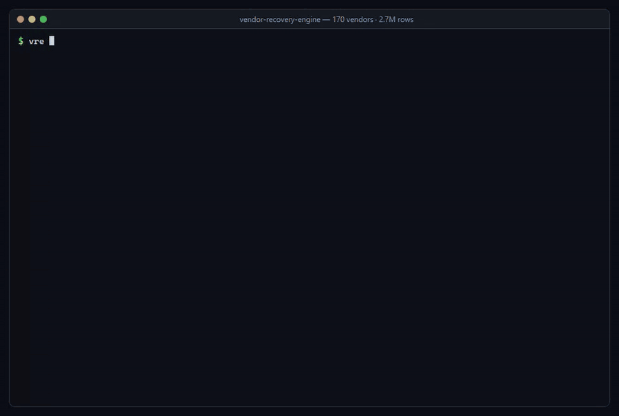

# Vendor Recovery Engine

[](https://github.com/jmnzcn/vendor-recovery-engine/actions/workflows/ci.yml)


Amazon pays its vendors net of deductions: shortages, price claims, chargebacks for late shipments
or late shipping notices. Some of those deductions are wrong. The carrier's proof of delivery shows
every carton arrived, or the invoice matched the agreed price, or the same deduction was taken twice.
Each one is a few dollars, but across a catalog and a year it adds up, and every dispute has a
deadline.

Checking them by hand means joining six exports that never line up. This project does that
automatically: it reads a vendor's purchase orders, shipments, proofs of delivery, invoices,
remittances and deductions, and for each deduction says whether it can be disputed, why, which row
of which file proves it, and which ones to file first.



There is also an [interactive results page](https://jmnzcn.github.io/vendor-recovery-engine/).

## What it found

I tested it on a synthetic world of 170 vendors (2.69 million rows in 1,020 Excel, CSV and Parquet
files) built on real product and exchange-rate data, using a seed I never used while developing:

- $895,010 recoverable in 34,807 claims, each one citing its source file and row.
- $81,055 of that expires within 30 days, so those claims go first in the work queue.
- $216,607 was recoverable but is already past the dispute window.
- 111,224 of 111,224 verdicts match the known answer, with $0 in false claims. All 612 ambiguous
  references were sent to review instead of being guessed.
- Against what really happened in the generated world (not just what the files can prove),
  precision is 100 % and recall 97.9 %. The missing 2.1 % is $19,543 that is real but can't be
  proven from the exports.
- The full run takes about 40 seconds on a laptop, plus 74 seconds for the Excel and PDF reports.

| Category | Claims | Recoverable | Past the window |
|---|---:|---:|---:|
| Unpaid invoices | 847 | $476,082 | $101,837 |
| Shortages (POD shows full delivery) | 18,701 | $210,208 | $57,813 |
| Exchange-rate variances | 2,977 | $48,984 | $11,260 |
| Late-shipment chargebacks | 1,821 | $47,846 | $16,023 |
| Price claims | 7,100 | $41,175 | $10,498 |
| Underpayments | 1,195 | $30,516 | $6,827 |
| ASN chargebacks | 940 | $23,997 | $8,117 |
| Duplicate deductions | 1,226 | $16,202 | $4,233 |

## One deduction, start to finish

From the [golden test set](tests/golden/observed/G0001/deductions.csv): Amazon deducted $10.00
for 4 units it says never arrived.

```
deductions.csv:2        SC100000001  SHORTAGE  ref INV-0001001  ASIN B0GOLD0001  qty 4  $10.00
  └ invoices.csv:2      INV-0001001  line for B0GOLD0001, PO 7KX2M9QA               (match: exact)
    └ shipments.csv:2   SHIPA00001   PO 7KX2M9QA, 3 cartons, BOL BOLA00000001
      └ proof_of_delivery.csv:2   POD-A1  3 of 3 cartons delivered 2026-03-13
Verdict  CLAIMABLE  $10.00  dispute by 2027-04-20  expected value $8.50
Reason   Carrier proof of delivery shows every carton delivered; the shortage is not supported.
```

## How I know the numbers are right

The data generator writes down the right answer for every deduction, and the engine never sees it.
`vre evaluate` compares the two and prints the exact number of wrong verdicts. That comparison found
four real bugs before I published this, including one that cost $88,757 in false claims (paid
invoices that looked unpaid because the remittance quoted the PO number) and one where `1.234,50`
was silently read as `1.2345`. The details are in [docs/EVALUATION_LOG.md](docs/EVALUATION_LOG.md).

I also degraded the same world step by step, removing proofs of delivery and mangling references.
Precision stayed at 100 % at every level; recall went down. In other words, when evidence goes
missing the engine stops claiming instead of guessing.

The rules, the robustness table, the tests and the data sources are in
[docs/how-it-works.md](docs/how-it-works.md).

## Dispute letters

`vre drafts` writes a letter for each claim, with Claude if you give it an API key, or from a
template if you don't. Either way a separate checker pulls out every amount, ID and date in the
letter and rejects it if any of them isn't in the evidence. To make sure the checker actually
works, I inject errors into valid letters (wrong amounts, shifted dates, invented document numbers):
it catches 975 of 975.

## Run it

Small example, about 30 seconds:

```bash
git clone https://github.com/jmnzcn/vendor-recovery-engine.git
cd vendor-recovery-engine
pip install -e ".[dev]"

vre generate demo --vendors 5 --po-lines 20000 --seed 7
vre run demo/observed --out demo/out          # Excel, PDF and CSV reports in demo/out
vre evaluate demo/out/findings.parquet demo/truth/truth.parquet
```

The full world from the results above (about 2.5 minutes to generate):

```bash
vre generate data/world --vendors 170 --po-lines 1200000 --seed 2026
vre run data/world/observed --out out
vre drafts out/findings.parquet --n 200       # add --model and ANTHROPIC_API_KEY to use Claude
pytest
```

To run it on real exports, put one folder per vendor with `purchase_orders`, `shipments`,
`proof_of_delivery`, `invoices`, `remittances` and `deductions` (`.parquet`, `.csv` or `.xlsx`)
and point `vre run` at the parent folder.

## Limits

- The data is synthetic. Real exports will bring things this world doesn't have yet: one payment
  covering dozens of invoices, remittance advice as PDF or email, deduction codes with their own
  evidence rules.
- Dispute windows and win rates in [`policy.py`](src/vre/policy.py) are my assumptions, not Amazon
  policy. With a real vendor, the win rates should come from their own dispute history.
- I used an AI coding assistant to write much of the code. I treated its output like any other
  input I don't trust: every rule is pinned by hand-written golden tests, and every run is scored
  against the known answers, which is how the bugs above were found.

## Resumen en español

Motor que concilia las deducciones de Amazon Vendor Central contra los registros del vendor y dice,
para cada una, si se puede disputar, por qué, qué fila de qué archivo lo prueba y cuál conviene
disputar primero. En un mundo sintético de 170 vendors y 2,7 millones de filas encontró $895.010
recuperables ($81.055 vencen en 30 días), coincidió con la respuesta correcta en los 111.224 casos y
no hizo ningún reclamo falso.

## License

[PolyForm Noncommercial 1.0.0](LICENSE). You can read, run and modify it for noncommercial purposes,
including evaluating it for a job. Commercial use, such as offering deduction recovery as a service,
needs a license from me: [neyfred@gmail.com](mailto:neyfred@gmail.com). Versions up to commit
`c5bc9b3` (2026-10-26) were released under MIT.

Ney Fred Jiménez Campos · [LinkedIn](https://www.linkedin.com/in/neyfred/) · [GitHub](https://github.com/jmnzcn)
