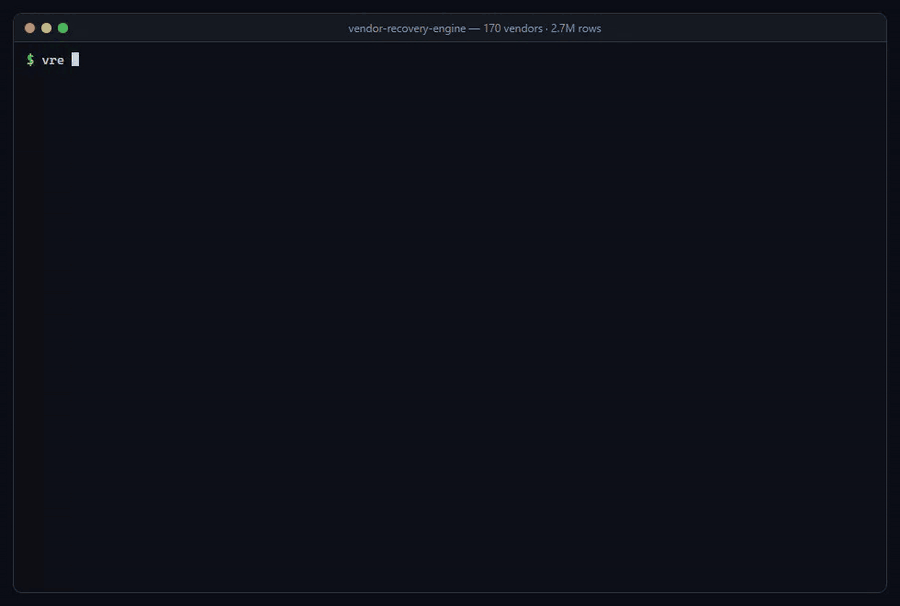
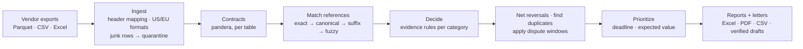
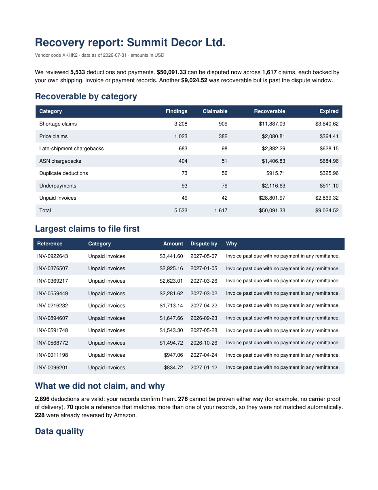

# 📦 Vendor Recovery Engine

**Reconciles Amazon Vendor Central deductions and payments against a vendor's own records, and tells you which ones can be disputed, why, which file row proves it, and which to file first.** Messy Excel/CSV/Parquet exports in; a prioritized claim queue, verified dispute letters, an Excel workbook and a PDF summary out.

[](https://github.com/jmnzcn/vendor-recovery-engine/actions/workflows/ci.yml)


**▶ [Explore the results interactively](https://jmnzcn.github.io/vendor-recovery-engine/)** · [Results](#-results) · [How it decides](#%EF%B8%8F-how-it-decides) · [Robustness](#-when-the-evidence-gets-worse) · [AI letters](#%EF%B8%8F-dispute-letters-ai-drafts-code-verifies) · [Evaluation](#-evaluation-scored-against-ground-truth) · [Run it](#-run-it) · [Resumen en español](#-resumen-en-español)



<sub>Real output of `vre run`, `vre evaluate` and `vre drafts` on the full dataset, replayed as a time-lapse (×15 on the long steps).</sub>

---

## 💸 The problem

Amazon pays vendors net of deductions: shortage claims, price claims, operational chargebacks. Some are wrong: the carrier's proof of delivery shows every carton arrived, the invoice was at the agreed cost, the shipment left inside the ship window, the same deduction was taken twice, a payment came short or at a bad exchange rate. Each one is small; across a catalog and a year they add up, and every dispute has a deadline.

Finding them means joining six exports that never line up: different formats, header styles, number and date conventions, and references quoted loosely (`inv 0012345`, `12345`, a truncated `2345`, a PO number with a typo).

## 📊 Results

One run on the full synthetic world (170 vendors), with a seed never used during development:

| | |
|---|---|
| **Rows reconciled** | **2.69 million** across 1,020 files (Parquet, CSV, Excel) from 170 vendors |
| **Recoverable now** | **$895,010** in **34,807 claims**, each with evidence and its source file and row |
| **File first** | **$81,055** in 3,003 claims whose dispute window closes within 30 days |
| **Lost to the dispute window** | **$216,607** that was recoverable but is past the deadline |
| **Against what the files can prove** | **111,224 of 111,224** verdicts match the ground truth · **$0 in false claims** · 612 of 612 ambiguous references sent to review |
| **Against what really happened** | precision **100 %**, **$0** false claims; recall **97.9 %**: $19,543 is real but cannot be proven from the exports |
| **Dispute letters** | 200 of 200 verified; the verifier caught **975 of 975** injected errors |
| **Runtime** | ingest 22 s + reconcile 18 s on a laptop; Excel, PDF and CSV reports for 170 vendors another 74 s |

| Category | Claims | Recoverable | Past the window |
|---|---:|---:|---:|
| Unpaid invoices | 847 | $476,082 | $101,837 |
| Shortage claims (POD shows full delivery) | 18,701 | $210,208 | $57,813 |
| Exchange-rate variances (worse than ECB beyond 0.5 %) | 2,977 | $48,984 | $11,260 |
| Late-shipment chargebacks (shipped inside the window) | 1,821 | $47,846 | $16,023 |
| Price claims (invoiced at PO cost) | 7,100 | $41,175 | $10,498 |
| Underpayments | 1,195 | $30,516 | $6,827 |
| ASN chargebacks (ASN sent on time) | 940 | $23,997 | $8,117 |
| Duplicate deductions | 1,226 | $16,202 | $4,233 |

**Two kinds of ground truth.** The generator records, for every deduction, both what a careful analyst can *prove* from the exports and what *really* happened (whether the cartons arrived even when the proof of delivery is missing; which invoice a truncated reference meant). Matching the first proves the rules are implemented consistently on messy inputs. The second is the honest test: the engine must never claim something false, and the money it cannot reach must be explained.

---

## 🔍 One deduction, end to end

Shortage claim `SC100000001` from the [golden test set](tests/golden/observed/G0001/deductions.csv): Amazon deducted $10.00 for 4 missing units.

```
deductions.csv:2        SC100000001  SHORTAGE  ref INV-0001001  ASIN B0GOLD0001  qty 4  $10.00
  └ invoices.csv:2      INV-0001001  line for B0GOLD0001, PO 7KX2M9QA               (match: exact)
    └ shipments.csv:2   SHIPA00001   PO 7KX2M9QA, 3 cartons, BOL BOLA00000001
      └ proof_of_delivery.csv:2   POD-A1  3 of 3 cartons delivered 2026-03-13
Verdict  CLAIMABLE  $10.00  dispute by 2027-04-20  expected value $8.50
Reason   Carrier proof of delivery shows every carton delivered; the shortage is not supported.
```

Every finding carries `source_file` and `source_row`, so a reviewer can open the vendor's own export and see the line.

---

## ⚖️ How it decides



**Matching refuses to guess.** A reference resolves on the first tier that yields exactly one record: the exact number, its canonical form (case, separators, leading zeros), a digits-only suffix of at least 4 digits, or (PO numbers only) a single PO one typo away. Two candidates on any tier send the deduction to **review**; none at all makes it **insufficient evidence**.

| Category | Evidence the engine checks | Claimable when |
|---|---|---|
| Shortage | invoice line → PO → shipment → carrier proof of delivery | POD shows every carton delivered |
| Price claim | invoice unit cost vs PO unit cost | invoiced at (or below) the PO cost |
| Late-shipment chargeback | ship date vs PO ship window | shipped inside the window |
| ASN chargeback | ASN date vs ship date | ASN sent no later than shipping |
| Duplicate deduction | same type, reference, ASIN, quantity and amount within 120 days | always (the repeat) |
| Underpayment | remittance paid vs invoice due at the applied rate | short by more than $1 with no deduction |
| Unpaid invoice | invoices with no payment in any remittance | past due date + 30 days |
| FX variance | applied rate vs ECB reference rate on the payment date | worse by more than 0.5 % |

Then: reversals Amazon already paid are netted (fully reversed → *already recovered*, partially → the remainder), anything past the dispute window becomes *expired* and is reported as money lost, and the **work queue** ranks the claims: windows closing within 30 days first, then expected value (amount × an assumed win rate for that kind of evidence, discounted for suffix or typo matches). Windows, tolerances and win rates live in [`policy.py`](src/vre/policy.py); they are configurable assumptions, not Amazon policy, and the win rates should be replaced by a vendor's own dispute history.

---

## 📉 When the evidence gets worse

[`scripts/robustness.py`](scripts/robustness.py) degrades the **same underlying world** step by step (more proofs of delivery missing, more shipment records missing, more truncated and mistyped references) and scores each level against what really happened. 2 seeds × 7 levels, 30 vendors each:

| Shipments without POD | Truncated refs | Precision | Recall | False claims | Real money not provable | Sent to review |
|---:|---:|---:|---:|---:|---:|---:|
| 0 % | 0 % | 100 % | 100.0 % | $0 | $0 | $0 |
| 6 % (default world) | 6 % | 100 % | 98.1 % | $0 | $2,693 | $313 |
| 18 % | 18 % | 100 % | 94.9 % | $0 | $7,652 | $537 |
| 30 % | 30 % | 100 % | 91.4 % | $0 | $12,734 | $1,082 |
| 60 % | 30 % | 100 % | 83.9 % | $0 | $24,855 | $1,082 |

Precision stays at 100 % and false claims at $0 at every level: when evidence disappears, the engine stops claiming instead of guessing. Recall pays for it, and almost all of the lost money is *missing evidence*, not ambiguity: **the cheapest way to recover more is to collect carrier proofs of delivery**, not to match more aggressively.

---

## ✉️ Dispute letters: AI drafts, code verifies

`vre drafts` writes a dispute letter for each claim with **Claude** (`claude-opus-5-5`, low effort, server-side fallback on refusal). The model sees only the facts of one finding. A deterministic [verifier](src/vre/disputes.py) then extracts every amount, identifier and date in the letter and requires each to appear in those facts, plus the reference and the disputed amount. A letter that fails is rejected, never patched by hand.

To prove the verifier is not a rubber stamp, every letter is re-checked up to five times, with one error injected each time: a changed amount, a shifted date, an invented document number, an invented proof of delivery, a dropped reference. **975 of 975 injected errors are caught.** The first version caught 968: it only checked identifiers containing digits, and PO numbers here can be all letters. The mutation test found the hole before any letter went out.

Without Anthropic credentials the same pipeline runs on an offline template (that is what the published numbers use); with them, `vre drafts --model` uses Claude and reports tokens and cost.

---

## 🧪 Evaluation: scored against ground truth

The generator writes the right answers into `truth/truth.parquet`; the engine never reads it. [`vre evaluate`](src/vre/evaluate.py) reports precision, recall, recovered vs recoverable dollars, false-claim dollars and the **exact** number of mismatched verdicts, against both what can be proven and what really happened.

**Bugs it caught** (numbers before and after in [docs/EVALUATION_LOG.md](docs/EVALUATION_LOG.md)):

1. **Paid invoices that looked unpaid.** Remittances that quote the PO number instead of the invoice number: precision **94.95 %, $88,757 in false claims**. Fix: match payments by PO when that PO has exactly one invoice.
2. **`1.234,50` read as `1.2345`, silently.** European exports also had `31.12.2025` dates that were rejected: recall **98.01 %, $2,669 missed**. Fix: detect the decimal separator per column per file; parse `DD.MM.YYYY`.
3. **A typo two edits away, found only on the holdout run.** Canonicalization drops leading zeros, so PO `MJPYNQ05` became `MJPYNQ5` and the one-typo reference `MJPYNQ0V` stopped matching: **5 wrong verdicts**, printed as "100.00 %" by the CLI. Fix: fuzzy matching on raw characters; the scorecard prints exact mismatch counts.
4. **An invented document number the letter verifier let through** (968 of 972 caught). Fix: any token with a digit, a hyphen or 8+ capitals counts as an identifier.

**Tests:**
- A **hand-built golden dataset** ([`tests/golden`](tests/golden)) with one case per rule and the expected answer written by hand, including quarantine line numbers and European formats.
- **Property-based tests** (hypothesis): ID normalization is invariant to case, separators and leading zeros; money round-trips through US and EU formats; a truncated reference is matched only when it is unique.
- **End-to-end:** generate a world, reconcile it, require zero disagreements; against reality, more noise must cost recall and never precision.
- **Letters:** every injected error is caught; valid letters pass; the all-letter identifier regression stays fixed.
- **CI** runs the suite on Python 3.11–3.13, then generates a **new world with a different seed on every run**, reconciles it, drafts letters, and fails the build on any disagreement, any false claim against reality, or any injected error the verifier misses.

---

## 🗂️ Data: what is real, what is synthetic

Real vendor data lives inside each vendor's Vendor Central account and is never public, so the project uses a hybrid:

| Real | Used for |
|---|---|
| [UCI Online Retail II](https://doi.org/10.24432/C5CG6D) (CC BY 4.0), 1.07M real transaction lines | product catalog, unit costs, order quantities, cancellation rates |
| [ECB euro reference rates](https://www.ecb.europa.eu/stats/policy_and_exchange_rates/euro_reference_exchange_rates/html/index.en.html) | every FX conversion and the FX-variance check (EUR, GBP, CAD, MXN, JPY) |
| [Amazon SP-API vendor models](https://github.com/amzn/selling-partner-api-models) | column names and shapes for orders, shipments and invoices |

**Synthetic, with known answers:** 170 vendors with made-up names (no real company is attached to a fabricated claim), their deductions, remittances and proofs of delivery, and the mess real exports have: mixed formats and header styles, US and EU number/date formats, glued exports with repeated headers and TOTAL rows, duplicated export rows, pending deductions with no number yet, truncated and mistyped references, payments quoting the PO instead of the invoice.

**With real data, expect more:** one payment covering dozens of invoices with deductions netted inside it, remittance advice that arrives as PDF or email, deduction codes that need their own evidence (co-op, damage allowances), and claim windows that differ by deduction type. Each new quirk becomes a generator feature and a row in the evaluation log before the engine is trusted with it.

---

## 📑 Outputs

Per vendor: an **Excel workbook** (summary, work queue sorted by priority, needs review, insufficient evidence, all findings, data quality), a **PDF summary** for a non-technical client that opens with what to file first, and a **dispute CSV** with priority, days left, expected value, reason, evidence and source row per claim. Across vendors: `claims_all_vendors.csv`, `portfolio_by_vendor.csv`, `summary.json`, `quarantine.csv` with every rejected row and why, and `drafts/` with the verified letters.



---

## 🚀 Run it

```bash
git clone https://github.com/jmnzcn/vendor-recovery-engine.git
cd vendor-recovery-engine
pip install -e ".[dev]"

vre generate data/world --vendors 170 --po-lines 1200000 --seed 2026   # ~2.5 min, ~2.7M rows
vre run data/world/observed --out out                                   # reports in out/
vre evaluate out/findings.parquet data/world/truth/truth.parquet
vre drafts out/findings.parquet --n 200          # --model uses Claude: pip install -e ".[ai]" + ANTHROPIC_API_KEY
python scripts/robustness.py                     # the robustness curve (~8 min)
pytest
```

The seeds built from the real datasets are committed (`data/seeds/`, 2.6 MB). To rebuild them from the sources: `vre fetch && vre seeds` (downloads ~46 MB, checksum-verified). To run on your own exports, put one folder per vendor with `purchase_orders`, `shipments`, `proof_of_delivery`, `invoices`, `remittances` and `deductions` files (any of `.parquet`, `.csv`, `.xlsx`) and point `vre run` at it.

```
src/vre/
  sources.py     download + checksum the real datasets, distill them into seeds
  generate.py    synthetic world: provable truth, real truth, a noise dial
  contracts.py   pandera schemas per table (SP-API-shaped column names)
  ingest.py      format detection, header mapping, quarantine, lineage, de-duplication
  normalize.py   IDs, money as integer cents, dates (US/EU/ISO)
  match.py       tiered reference matching that refuses to guess
  reconcile.py   evidence rules, reversals, duplicates, dispute windows
  triage.py      work queue: deadline first, then expected value
  disputes.py    Claude-drafted letters, deterministic verifier, mutation test
  evaluate.py    scorecard against provable and real ground truth
  reports.py     Excel, PDF, dispute CSV, portfolio summary
  cli.py         vre fetch | seeds | generate | run | evaluate | drafts
```

**Engineering choices:** money is integer cents end to end; every row keeps its source file and line; bad rows are quarantined with a reason, never dropped silently; a reference that matches two records is never auto-matched; files are parsed in parallel, contracts run once per table; generated worlds are deterministic per seed, and the noise dial draws from its own random stream so every level degrades the same world.

**How AI is used:** in the product, Claude drafts the dispute letters and code verifies them. In building it, an AI coding assistant wrote much of the code; its output is treated like any other untrusted input: every rule is pinned by the golden tests and every run is scored against the ground truth, which is how the four bugs above were caught.

**Next:** remittance advice from PDF/email, measured win rates from real dispute outcomes in place of the priors, and DuckDB for 50M+ row histories.

---

## 🇪🇸 Resumen en español

Motor de conciliación para deducciones de Amazon Vendor Central. Cruza las exportaciones del vendor (órdenes de compra, envíos, pruebas de entrega, facturas, pagos y deducciones) y decide para cada deducción:
- si se puede disputar y por qué;
- qué fila de qué archivo lo prueba;
- cuál conviene disputar primero.

Sobre un mundo sintético construido con datos reales (UCI Online Retail II y tipos de cambio del BCE), con 170 vendors y 2,7 millones de filas:
- encontró **$895.010 recuperables**, de los cuales **$81.055 vencen en 30 días**;
- coincidió con la respuesta correcta en **111.224 de 111.224** casos, sin reclamos falsos;
- medido contra lo que **realmente** pasó, mantiene el 100 % de precisión aunque la evidencia empeore: lo que no puede probar no lo reclama.

Las cartas de disputa las redacta Claude y las verifica un programa determinista, que atrapó 975 de 975 errores inyectados. La evaluación atrapó cuatro errores reales antes de publicar.

---

**Ney Fred Jiménez Campos** · [LinkedIn](https://www.linkedin.com/in/neyfred/) · [GitHub](https://github.com/jmnzcn) · MIT License
