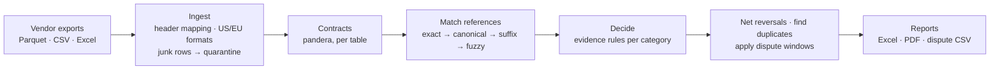

# 📦 Vendor Recovery Engine

**Reconciles Amazon Vendor Central deductions and payments against a vendor's own records, and tells you which ones can be disputed, why, and which file row proves it.** Messy Excel/CSV/Parquet exports in; a dispute-ready claim list, an Excel workbook and a PDF summary out.

[](https://github.com/jmnzcn/vendor-recovery-engine/actions/workflows/ci.yml)


**▶ [Explore the results interactively](https://jmnzcn.github.io/vendor-recovery-engine/)** · [How it decides](#-how-it-decides) · [Evaluation](#-evaluation-scored-against-ground-truth) · [Data](#-data-what-is-real-what-is-synthetic) · [Run it](#-run-it) · [Resumen en español](#-resumen-en-español)


<sub>Real output of `vre run` and `vre evaluate` on the full dataset, replayed as a time-lapse (×15 on the long steps).</sub>

---

## 💸 The problem

Amazon pays vendors net of deductions: shortage claims, price claims, operational chargebacks. Some are wrong: the carrier's proof of delivery shows every carton arrived, the invoice was at the agreed cost, the shipment left inside the ship window, the same deduction was taken twice, a payment came short or at a bad exchange rate. Each one is small; across a catalog and a year they add up, and every dispute has a deadline.

Finding them means joining six exports that never line up: different formats, header styles, number and date conventions, and references quoted loosely (`inv 0012345`, `12345`, a truncated `2345`, a PO number with a typo).

## 📊 Results

One run on the full synthetic world (170 vendors), with a seed never used during development:

| | |
|---|---|
| **Rows reconciled** | **2.69 million** across 1,020 files (Parquet, CSV, Excel) from 170 vendors |
| **Recoverable now** | **$910,932** in **34,709 claims**, each with evidence and its source file and row |
| **Lost to the dispute window** | **$233,791** that was recoverable but is past the deadline |
| **Verdicts vs ground truth** | **112,330 of 112,330** match · claimable precision **100 %** · recall **100 %** · **$0 in false claims** |
| **Ambiguous references** | **583 of 583** sent to review, none auto-matched |
| **Runtime** | ingest 26 s + reconcile 19 s on a laptop; reports for 170 vendors another 77 s |

| Category | Claims | Recoverable | Past the window |
|---|---:|---:|---:|
| Unpaid invoices | 819 | $484,871 | $111,961 |
| Shortage claims (POD shows full delivery) | 18,688 | $210,099 | $60,585 |
| Late-shipment chargebacks (shipped inside the window) | 1,866 | $49,652 | $17,099 |
| Exchange-rate variances (worse than ECB beyond 0.5 %) | 2,915 | $48,982 | $13,453 |
| Price claims (invoiced at PO cost) | 7,104 | $43,608 | $10,239 |
| Underpayments | 1,233 | $34,656 | $8,561 |
| ASN chargebacks (ASN sent on time) | 921 | $23,615 | $8,177 |
| Duplicate deductions | 1,163 | $15,450 | $3,717 |

**Why the 100 % deserves suspicion, and why it holds up:** the generator labels its ground truth with the same business rules the engine applies, so a perfect score proves the rules are implemented consistently on messy inputs, not that real data would score the same. The benchmark earned its keep when it failed: it caught [three real bugs](#-evaluation-scored-against-ground-truth), one of them only on the holdout run.

---

## 🔍 One deduction, end to end

Shortage claim `SC100000001` from the [golden test set](tests/golden/observed/G0001/deductions.csv): Amazon deducted $10.00 for 4 missing units.

```
deductions.csv:2        SC100000001  SHORTAGE  ref INV-0001001  ASIN B0GOLD0001  qty 4  $10.00
  └ invoices.csv:2      INV-0001001  line for B0GOLD0001, PO 7KX2M9QA               (match: exact)
    └ shipments.csv:2   SHIPA00001   PO 7KX2M9QA, 3 cartons, BOL BOLA00000001
      └ proof_of_delivery.csv:2   POD-A1  3 of 3 cartons delivered 2026-03-13
Verdict  CLAIMABLE  $10.00  dispute by 2027-04-20
Reason   Carrier proof of delivery shows every carton delivered; the shortage is not supported.
```

Every finding carries `source_file` and `source_row`, so a reviewer can open the vendor's own export and see the line.

---

## ⚖️ How it decides



**Matching refuses to guess.** A reference resolves on the first tier that yields exactly one record: the exact number, its canonical form (case, separators, leading zeros), a digits-only suffix of at least 4 digits, or (PO numbers only) a single PO one typo away. Two candidates on any tier send the deduction to **review**; none at all makes it **insufficient evidence**.

| Category | Evidence the engine checks | Claimable when |
|---|---|---|
| Shortage | invoice line → PO → shipment → carrier proof of delivery | POD shows every carton delivered |
| Price claim | invoice unit cost vs PO unit cost | invoiced at (or below) the PO cost |
| Late-shipment chargeback | ship date vs PO ship window | shipped inside the window |
| ASN chargeback | ASN date vs ship date | ASN sent no later than shipping |
| Duplicate deduction | same type, reference, ASIN, quantity and amount within 120 days | always (the repeat) |
| Underpayment | remittance paid vs invoice due at the applied rate | short by more than $1 with no deduction |
| Unpaid invoice | invoices with no payment in any remittance | past due date + 30 days |
| FX variance | applied rate vs ECB reference rate on the payment date | worse by more than 0.5 % |

Then: reversals Amazon already paid are netted (fully reversed → *already recovered*, partially → the remainder), and anything older than the dispute window becomes *expired* and is reported as money lost. Windows and tolerances live in [`policy.py`](src/vre/policy.py); they are configurable assumptions, not Amazon policy.

---

## 🧪 Evaluation: scored against ground truth

The generator writes the right answer for every deduction and payment problem into `truth/truth.parquet`. The engine never reads it; [`vre evaluate`](src/vre/evaluate.py) compares afterwards and reports precision, recall, recovered vs recoverable dollars, false-claim dollars and the **exact** number of mismatched verdicts.

**Bugs it caught** (full numbers in [docs/EVALUATION_LOG.md](docs/EVALUATION_LOG.md)):

1. **Paid invoices that looked unpaid.** Remittances that quote the PO number instead of the invoice number left 154 paid invoices looking unpaid: precision **94.95 %, $88,757 in false claims**. Fix: match payments by PO when that PO has exactly one invoice.
2. **`1.234,50` read as `1.2345`, silently.** European exports also had `31.12.2025` dates that were rejected, which quarantined two vendors: recall **98.01 %, $2,669 missed**. Fix: detect the decimal separator per column per file; parse `DD.MM.YYYY`.
3. **A typo two edits away, found only on the holdout run.** Canonicalization drops leading zeros, so PO `MJPYNQ05` became `MJPYNQ5` and the one-typo reference `MJPYNQ0V` no longer matched: **5 wrong verdicts out of 112,330**, which the CLI printed as "100.00 %". Fix: fuzzy matching on raw characters, and the scorecard now prints the exact mismatch count.

**Tests:**
- A **hand-built golden dataset** ([`tests/golden`](tests/golden)) with one case per rule and the expected answer written by hand, including quarantine line numbers and European formats.
- **Property-based tests** (hypothesis): ID normalization is invariant to case, separators and leading zeros; money round-trips through US and EU formats; a truncated reference is matched only when it is unique.
- **End-to-end:** generate a world, reconcile it, require zero disagreements with the truth; generation is deterministic per seed.
- **CI** runs the suite on Python 3.11–3.13, then generates a **new world with a different seed on every run** and fails the build on any disagreement with the ground truth.

---

## 🗂️ Data: what is real, what is synthetic

Real vendor data lives inside each vendor's Vendor Central account and is never public, so the project uses a hybrid:

| Real | Used for |
|---|---|
| [UCI Online Retail II](https://doi.org/10.24432/C5CG6D) (CC BY 4.0), 1.07M real transaction lines | product catalog, unit costs, order quantities, cancellation rates |
| [ECB euro reference rates](https://www.ecb.europa.eu/stats/policy_and_exchange_rates/euro_reference_exchange_rates/html/index.en.html) | every FX conversion and the FX-variance check (EUR, GBP, CAD, MXN, JPY) |
| [Amazon SP-API vendor models](https://github.com/amzn/selling-partner-api-models) | column names and shapes for orders, shipments and invoices |

**Synthetic, with known answers:** 170 vendors with made-up names (no real company is attached to a fabricated claim), their deductions, remittances and proofs of delivery, and the mess real exports have: mixed formats and header styles, US and EU number/date formats, glued exports with repeated headers and TOTAL rows, duplicated export rows, pending deductions with no number yet, truncated and mistyped references, payments quoting the PO instead of the invoice.

**With real data, expect more:** one payment covering dozens of invoices with deductions netted inside it, remittance advice that arrives as PDF or email, deduction codes that need their own evidence (co-op, damage allowances), and claim windows that differ by deduction type. Each new quirk becomes a generator feature and a row in the evaluation log before the engine is trusted with it.

---

## 📑 Outputs

Per vendor: an **Excel workbook** (summary, claims sorted by deadline, needs review, insufficient evidence, all findings, data quality), a **PDF summary** for a non-technical client, and a **dispute CSV** with amount, deadline, reason, evidence and source row per claim. Across vendors: `claims_all_vendors.csv`, `portfolio_by_vendor.csv`, `summary.json`, and `quarantine.csv` with every rejected row and why.


---

## 🚀 Run it

```bash
git clone https://github.com/jmnzcn/vendor-recovery-engine.git
cd vendor-recovery-engine
pip install -e ".[dev]"

vre generate data/world --vendors 170 --po-lines 1200000 --seed 2026   # ~3 min, ~2.7M rows
vre run data/world/observed --out out                                   # reports in out/
vre evaluate out/findings.parquet data/world/truth/truth.parquet
pytest
```

The seeds built from the real datasets are committed (`data/seeds/`, 2.6 MB). To rebuild them from the sources: `vre fetch && vre seeds` (downloads ~46 MB, checksum-verified). To run on your own exports, put one folder per vendor with `purchase_orders`, `shipments`, `proof_of_delivery`, `invoices`, `remittances` and `deductions` files (any of `.parquet`, `.csv`, `.xlsx`) and point `vre run` at it.

```
src/vre/
  sources.py     download + checksum the real datasets, distill them into seeds
  generate.py    synthetic vendor world with injected discrepancies and ground truth
  contracts.py   pandera schemas per table (SP-API-shaped column names)
  ingest.py      format detection, header mapping, quarantine, lineage, de-duplication
  normalize.py   IDs, money as integer cents, dates (US/EU/ISO)
  match.py       tiered reference matching that refuses to guess
  reconcile.py   evidence rules, reversals, duplicates, dispute windows
  evaluate.py    scorecard against ground truth
  reports.py     Excel, PDF, dispute CSV, portfolio summary
  cli.py         vre fetch | seeds | generate | run | evaluate
```

**Engineering choices:** money is integer cents end to end; every row keeps its source file and line; bad rows are quarantined with a reason, never dropped silently; a reference that matches two records is never auto-matched; files are parsed in parallel, contracts run once per table.

**How AI was used:** built with an AI coding assistant. Its output is treated like any other untrusted input: every rule is pinned by the golden tests and every run is scored against the ground truth, which is how the three bugs above were caught.

**Next:** remittance advice from PDF/email, LLM-drafted dispute letters whose every number is checked against the finding before sending, and DuckDB for 50M+ row histories.

---

## 🇪🇸 Resumen en español

Motor de conciliación para deducciones de Amazon Vendor Central. Cruza las exportaciones del vendor (órdenes de compra, envíos, pruebas de entrega, facturas, pagos y deducciones) y decide, para cada deducción, si se puede disputar, por qué y qué fila de qué archivo lo prueba. Sobre un mundo sintético construido con datos reales (UCI Online Retail II y tipos de cambio del BCE) de 170 vendors y 2,7 millones de filas, encontró **$910.932 recuperables** y **$233.791 ya vencidos**. Coincidió con la respuesta correcta en **112.330 de 112.330** casos, sin reclamos falsos. La evaluación contra la verdad conocida atrapó tres errores reales antes de publicar.

---

**Ney Fred Jiménez Campos** · [LinkedIn](https://www.linkedin.com/in/neyfred/) · [GitHub](https://github.com/jmnzcn) · MIT License
