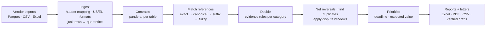
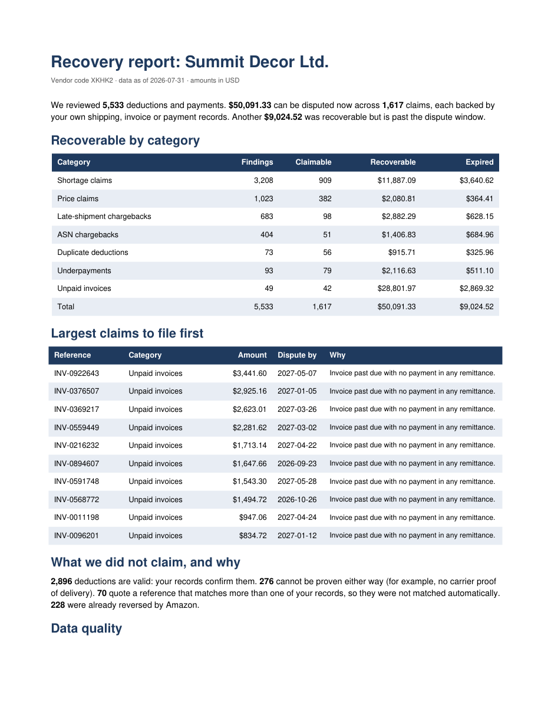

# How it works

The README covers what the engine does and what it found. This page has the rules, the robustness
numbers, the tests and the data sources.

## The pipeline



## Matching references

Amazon quotes invoice and PO numbers loosely. A reference is resolved by the first tier that gives
exactly one record:

1. the number as written;
2. its canonical form (case, separators and leading zeros removed);
3. a digits-only suffix of at least 4 digits;
4. for PO numbers only, a single PO one typo away.

If a tier finds two candidates, the deduction goes to review instead of being matched. If no tier
finds anything, it is marked as insufficient evidence. I made it this conservative on purpose: a
wrong match produces a false claim, and a false claim costs more than a missed one.

## Evidence rules

| Category | What gets checked | Claimable when |
|---|---|---|
| Shortage | invoice line → PO → shipment → carrier proof of delivery | the POD shows every carton delivered |
| Price claim | invoice unit cost vs PO unit cost | invoiced at or below the PO cost |
| Late-shipment chargeback | ship date vs PO ship window | shipped inside the window |
| ASN chargeback | ASN date vs ship date | ASN sent no later than shipping |
| Duplicate deduction | same type, reference, ASIN, quantity and amount within 120 days | always (the repeat) |
| Underpayment | remittance paid vs invoice due at the applied rate | short by more than $1 with no deduction |
| Unpaid invoice | invoices with no payment in any remittance | past due date + 30 days |
| FX variance | applied rate vs ECB reference rate on the payment date | worse by more than 0.5 % |

After that, reversals Amazon already paid are netted (fully reversed means already recovered;
partially, the remainder is still claimable), anything past its dispute window is reported as
money lost, and the work queue sorts claims by deadline (closing within 30 days first) and then by
expected value: amount times an assumed win rate for that kind of evidence, discounted for suffix
or typo matches.

Windows, tolerances and win rates are in [`policy.py`](../src/vre/policy.py). They are my
assumptions, not Amazon policy; with real data the win rates should come from the vendor's own
dispute history.

## When the evidence gets worse

[`scripts/robustness.py`](../scripts/robustness.py) takes one world and degrades it step by step:
more proofs of delivery missing, more shipment records missing, more truncated and mistyped
references. Each level is scored against what really happened (2 seeds × 7 levels, 30 vendors each):

| Shipments without POD | Truncated refs | Precision | Recall | False claims | Real money not provable | Sent to review |
|---:|---:|---:|---:|---:|---:|---:|
| 0 % | 0 % | 100 % | 100.0 % | $0 | $0 | $0 |
| 6 % (default world) | 6 % | 100 % | 98.1 % | $0 | $2,693 | $313 |
| 18 % | 18 % | 100 % | 94.9 % | $0 | $7,652 | $537 |
| 30 % | 30 % | 100 % | 91.4 % | $0 | $12,734 | $1,082 |
| 60 % | 30 % | 100 % | 83.9 % | $0 | $24,855 | $1,082 |

Precision never drops; recall does. Most of the money lost at the higher levels is missing
evidence, not ambiguous references, so for a real vendor the best investment is collecting
carrier proofs of delivery rather than matching more aggressively.

## Dispute letters

`vre drafts` writes one letter per claim. With an Anthropic key it uses Claude
(`claude-opus-5-5`, low effort); without one it fills an offline template, which is what the
published numbers use. The model only sees the facts of one finding.

[`disputes.py`](../src/vre/disputes.py) then pulls every amount, identifier and date out of the
letter and checks that each one appears in those facts, along with the reference and the disputed
amount. Letters that fail are rejected, not edited.

To test the checker itself, each letter is re-checked up to five times with one error injected each
time: a changed amount, a shifted date, an invented document or POD number, a dropped reference.
It catches 975 of 975. The first version caught 968, because it only treated tokens with digits as
identifiers and some PO numbers here are all letters.

## Evaluation and tests

The generator writes the right answer for every deduction into `truth/truth.parquet`, which the
engine never reads. [`vre evaluate`](../src/vre/evaluate.py) compares against it and reports
precision, recall, dollars recovered, dollars falsely claimed and the exact number of wrong verdicts.

There are two answers per deduction: what can be proven from the exports, and what really happened
(for example, whether the cartons arrived even when the POD is missing). The first checks that the
rules are applied consistently on messy files. The second is the one that matters for a vendor: the
engine should never claim something false, and the money it misses should be explainable.

Bugs the evaluation caught, with before/after numbers in [EVALUATION_LOG.md](EVALUATION_LOG.md):

1. Remittances that quote the PO number instead of the invoice number made paid invoices look
   unpaid: precision 94.95 %, $88,757 in false claims. Fixed by matching payments by PO when that
   PO has exactly one invoice.
2. `1.234,50` was read as `1.2345` without any error, and `31.12.2025` dates were rejected:
   recall 98.01 %. Fixed by detecting the decimal separator per column and file.
3. Canonicalization drops leading zeros, so PO `MJPYNQ05` became `MJPYNQ5` and the one-typo
   reference `MJPYNQ0V` stopped matching. Five wrong verdicts, which the CLI printed as "100.00 %".
   Found only on the holdout run. Fuzzy matching now uses the raw characters, and the scorecard
   prints exact counts.
4. The letter checker let an invented all-letter document number through (968 of 972).

Test suite:

- a hand-built golden dataset ([`tests/golden`](../tests/golden)) with one case per rule and the
  expected answer written by hand, including quarantine line numbers and European formats;
- property-based tests (hypothesis) for ID normalization, money in US and EU formats, and suffix
  matching only when unique;
- end-to-end runs that generate a world, reconcile it and require zero disagreements;
- the letter mutation test;
- CI on Python 3.11 to 3.13, which also generates a world with a new seed on every run and fails on
  any disagreement, any false claim, or any injected error the checker misses.

## Data

Real vendor data stays inside each vendor's Vendor Central account, so the world is synthetic but
built on real data where it can be:

| Real source | Used for |
|---|---|
| [UCI Online Retail II](https://doi.org/10.24432/C5CG6D) (CC BY 4.0), 1.07M transaction lines | catalog, unit costs, order quantities, cancellation rates |
| [ECB euro reference rates](https://www.ecb.europa.eu/stats/policy_and_exchange_rates/euro_reference_exchange_rates/html/index.en.html) | every FX conversion and the FX-variance check |
| [Amazon SP-API vendor models](https://github.com/amzn/selling-partner-api-models) | column names and shapes for orders, shipments and invoices |

The 170 vendors have made-up names. Their deductions, remittances and proofs of delivery are
generated, along with the mess real exports have: mixed formats and header styles, US and EU number
and date formats, glued exports with repeated headers and TOTAL rows, duplicated rows, pending
deductions with no number yet, truncated and mistyped references, payments that quote the PO.

Real data will have more: one payment covering dozens of invoices with deductions netted inside,
remittance advice as PDF or email, deduction codes with their own evidence (co-op, damage
allowances), and windows that differ by deduction type.

## Outputs

Per vendor: an Excel workbook (summary, work queue, needs review, insufficient evidence, all
findings, data quality), a PDF summary for someone non-technical that starts with what to file first,
and a dispute CSV. Across vendors: `claims_all_vendors.csv`, `portfolio_by_vendor.csv`,
`summary.json`, `quarantine.csv` with every rejected row and the reason, and `drafts/` with the
checked letters.



## Code map

```
src/vre/
  sources.py     download + checksum the real datasets, distill them into seeds
  generate.py    synthetic world: provable truth, real truth, a noise dial
  contracts.py   pandera schemas per table (SP-API-shaped column names)
  ingest.py      format detection, header mapping, quarantine, lineage, de-duplication
  normalize.py   IDs, money as integer cents, dates (US/EU/ISO)
  match.py       tiered reference matching
  reconcile.py   evidence rules, reversals, duplicates, dispute windows
  triage.py      work queue: deadline first, then expected value
  disputes.py    letters (Claude or template) and the checker
  evaluate.py    scorecard against provable and real ground truth
  reports.py     Excel, PDF, dispute CSV, portfolio summary
  cli.py         vre fetch | seeds | generate | run | evaluate | drafts
```

A few decisions worth knowing: money is integer cents from ingest to report; every row keeps its
source file and line; bad rows go to quarantine with a reason instead of being dropped; files are
parsed in parallel and contracts run once per table; worlds are deterministic per seed, and the noise
dial uses its own random stream, so every noise level degrades the same world.
